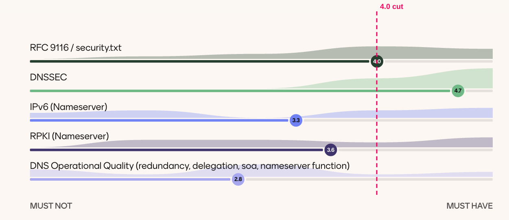
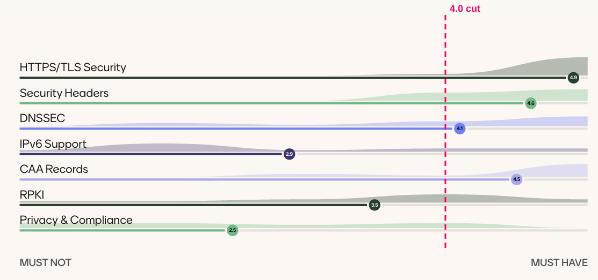
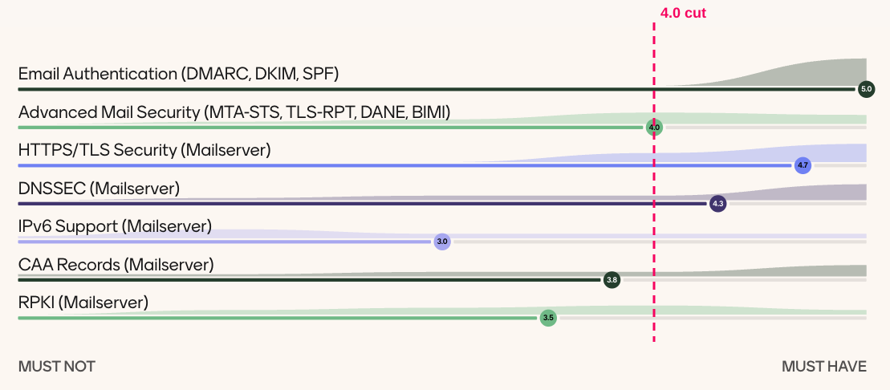

# Introduction

## Background

Several ccTLD registries measure the security configuration of the domain names in their zones. They publish the results to encourage registrars and domain holders to follow best practices for the services behind a domain name, mainly websites and e-mail. .ie presented its Domain Security Scorecard at the CENTR R&D meeting and the CENTR Jamboree in 2023. Other registries, such as .nl, use similar metrics.

These initiatives use different approaches, so their results cannot be compared. Different tools also carry out the same test in different ways, and there is no common reference. After the 28th CENTR R&D Workshop in Stockholm, CENTR formed the Domain Security Scorecard Task Force (TF) to address these problems.

## Goals and Scope

The goal of the TF was to define a methodology for comparable and reproducible statistics on the security configuration of domain names. Every TLD should be able to apply the methodology in the same way. This allows analysis and benchmarking across ccTLDs, at the level of a whole registry, a registrar, a business model or a domain category (e.g. DIT categories).

The TF charter defined two deliverables:

- an agreed and documented methodology for repeatable assessment of the security configuration of a domain name (this document)
- a mapping of existing tools and solutions to this methodology

The methodology supports these use cases:

- statistics for one's own TLD
- statistics for segments of a TLD, for example by DIT category or registrar model
- comparison between TLDs

The results are relevant to registries, registrars, domain holders and administrators, policymakers and the general public. They can be reported as current values or as changes over time.

The long-term goal in the TF charter was to express the security quality of a domain name as a single number. This version of the document defines the individual tests and their Pass/Fail results only. How test results are combined into one score is out of scope for this version and is left for future work.

## Added Value of This Document

Most tests in this document correspond to tests performed by [Internet.nl](https://internet.nl), which in turn are based on the NCSC-NL guidelines. The selection of tests is one contribution of this document. The main contribution, however, is that it describes how to conduct each test.

No such description exists for Internet.nl. Its result pages explain what a test checks, but not how the check is carried out. The test procedures in this document are based on those result pages and on an analysis of the Internet.nl source code, supported by AI tools. Anyone can use them to implement the tests independently and get the same results, without having to run the Internet.nl implementation.

To a great extent, the evaluation can be done with Internet.nl. However, many registries already crawl DNS and web data for other purposes. This document allows them to evaluate their existing data and still get results that are consistent with other implementations.

## Test Selection Methodology

The TF selected the tests in three steps:

1. Collect all possible tests: The initial set came from existing scorecards and tools:
   - .ie / DENIC: 28 tests from the .ie scorecard, with test descriptions from DENIC, covering web and mail
   - Internet.nl: 34 tests in the mail suite and 37 tests in the web suite
   - EURid: 48 tests covering connectivity, DNSSEC, name servers and SOA
   - Red.es: 16 tests of further features (e.g. certificate type, BIMI, MTA-STS, GDPR/privacy)
2. Make a selection: The TF limited the scope to the following areas:
   - transport security for web and e-mail
   - signalling over DNS
   - properties in HTTP headers
   - `.well-known` files
   - DNS delegation

   The TF grouped the candidate tests into categories. TF members then rated each category on a scale from 1 (MUST NOT) to 5 (MUST HAVE). A category was selected if its average rating was 4.0 or higher. The results are shown below. The dashed line marks the 4.0 cut-off.
3. Write down the methodology: For each selected test, the TF wrote a specification with a summary, a test procedure, scoring and references. Where possible, the TF reused Internet.nl test descriptions.

### Results of the TF rating per category:

#### Domain

Selected: RFC 9116 / security.txt (D.1) and DNSSEC (D.2).

#### Web

Selected: HTTPS/TLS Security (W.1), Security Headers (W.2) and CAA Records (W.3). Web DNSSEC is covered by the Domain DNSSEC tests (D.2).

#### Mail

Selected: Email Authentication (M.1), Advanced Mail Security (M.2, plus DANE in M.3.11–M.3.12), HTTPS/TLS Security of the mail server (M.3) and DNSSEC of the mail server domain (M.4).

The final set contains 44 tests: 3 Domain tests, 22 Mail tests and 19 Web tests.

## Scope and Entry Points for Web Tests

The result of a web test can depend on the entry point: apex domain or `www`, IPv4 or IPv6, `http` or `https`, and any redirect chains. The TF ran experiments to agree on an approach. The findings were:

- **IPv4 vs. IPv6:** if IPv6 is configured, the target URL is the same as for IPv4 in 99% of cases (.de).
- **http vs. https:** 65% of `http` URLs redirect to the same URL over `https`, and 96% redirect within the same domain (.de). For `http`, only the redirect to `https` needs to be checked (W.1.2).
- **Apex vs. www:** only 1–2% of domains are configured as "www only" (.de), and TLS security properties match in 94–98% of cases (.be). The TF therefore considered testing the apex domain sufficient.
- **Redirects:** some tests, in particular the HTTP header tests, follow the redirect chain to the final site (.ie experience). The TF did not conclude on a general approach to redirects. Therefore the entry point used by a test is given in its test procedure.

## Status of This Document

This document has not yet been verified by independent implementations. Implementations are in progress. They may find inconsistencies or unclear descriptions, so the test descriptions may change in later versions.
